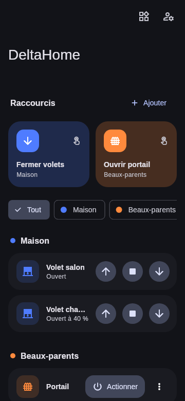

# Domus — domotique Delta Dore

Un assistant vocal futuriste pour piloter **plusieurs comptes Delta Dore / Tydom en même temps** :
vos volets (votre compte) et le portail de la famille (leur compte), sans jamais
vous déconnecter. À la voix (« Orion, ferme les volets »), par curseurs holographiques,
ou par des **boutons sur l'écran d'accueil** du téléphone.

## Fonctionnalités

- **Deux assistants au choix** : **Orion** (voix masculine, thème cyan) ou **Nova**
  (voix féminine, thème violet). Touchez le réacteur (ou dites son nom si le mot d'activation
  est configuré) puis parlez : « ferme les volets », « ouvre le portail chez les beaux-parents »,
  « mets le volet du salon à 30 % », « stop les volets partout », « fais-moi un rapport »…
  L'assistant répond à voix haute et agit. En cas de doute (« quelle maison ? »), il demande.
- **Voix IA intégrées** : voix neuronales (Piper) générées sur le téléphone, sans Internet
  ni compte : *Pierre* pour Orion, *Siwis* ou *Jessica* pour Nova, avec un effet « IA » réglable.
  Téléchargement unique (67 à 80 Mo) au premier choix ; la voix du téléphone reste disponible.
- **Voix ElevenLabs (option)** : voix ultra réalistes avec votre propre compte ElevenLabs
  (clé API dans *Menu → Assistant*), une voix pour Orion et une pour Nova, phrases mises en
  cache pour économiser les crédits, repli automatique sur la voix intégrée sans Internet.
- **Interface HUD** futuriste : réacteur animé qui réagit à la voix, curseurs verticaux
  pour régler chaque volet (et « Tous »), « maintenir pour activer » pour portail et garage.

- **Multi-comptes** : ajoutez autant de comptes Tydom que nécessaire (« Maison »,
  « Beaux-parents »…). Chacun a sa couleur ; tous restent connectés.
- **Détection automatique** des box et des équipements (volets, portail, garage, lumières).
- **Raccourcis en un tap** : « Fermer volets » (tous les volets d'un compte d'un coup),
  « Ouvrir portail »… Créés automatiquement à l'ajout d'un compte, modifiables (appui long).
- **Widgets Android et iPhone** :
  - *Bouton DeltaHome* : 1 bouton = 1 action, au choix ;
  - *Raccourcis DeltaHome* : vos 4 premiers raccourcis ;
  - l'action s'exécute **sans ouvrir l'app**, le bouton affiche ⏳ puis ✓ ou ⚠.
- **Raccourcis de l'icône** : appui long sur l'icône de l'app → 4 premiers raccourcis.
- Interface Material 3, thème clair / sombre automatique.
- Identifiants **chiffrés** sur le téléphone (Keystore Android / Trousseau iOS).
  Ils ne sont envoyés qu'aux serveurs Delta Dore.

## Installer sur Android

**Le plus simple :** à chaque push, GitHub compile l'APK.
Onglet **Actions** du dépôt → dernier *APK Android* réussi → *Artifacts* →
`DeltaHome-apk` → décompressez et ouvrez `app-release.apk` sur le téléphone
(autorisez l'installation depuis cette source).

Ou en local : `flutter build apk --release` (Flutter 3.50+, SDK Android).

Ajouter le widget : appui long sur l'écran d'accueil → *Widgets* → *Domus*
(« Assistant vocal » pour parler, « Bouton Domus » et « Protocoles Domus »).

### Mains libres : « Orion… » / « Nova… » (facultatif)

*Menu → Assistant → Mains libres* : quand l'app est ouverte, dites le nom de l'assistant puis votre
demande, ou tout d'une traite (« Nova, ferme les volets »). Aucun compte ni clé : c'est la
reconnaissance vocale du téléphone qui écoute. Le son du téléphone est coupé pendant l'écoute du
prénom pour éviter les bips de certains Android, puis rétabli dès que l'assistant répond.
Quand l'app est fermée, Android et iOS ne permettent pas d'écouter le micro en continu sans
notification permanente et forte consommation de batterie : le widget « Assistant vocal » est la porte d'entrée.

## Installer sur iPhone

Voir [docs/IPHONE.md](docs/IPHONE.md) (Mac + Xcode nécessaires, iOS 17+ pour les widgets).

## Utilisation

1. Ouvrez l'app → **Ajouter un compte** → nom affiché, e-mail et mot de passe
   **de l'application Tydom** de ce compte, et **adresse MAC de la box**
   (étiquette sous la box Tydom, 12 caractères, souvent `001A25…`).
2. Recommencez pour le second compte (ex. celui des beaux-parents).
3. Les équipements apparaissent par compte ; les raccourcis sont proposés automatiquement.
4. Placez les widgets sur l'écran d'accueil.

L'adresse MAC est obligatoire : le service Delta Dore ne donne le mot de passe
d'une box que si on lui fournit son adresse MAC. Plusieurs box sur un même compte :
séparez les adresses par une virgule.

## Fonctionnement technique

| Fichier | Rôle |
| --- | --- |
| `lib/tydom/cloud.dart` | Connexion au compte Delta Dore, récupération des box (MAC + mot de passe box) |
| `lib/tydom/client.dart` | WebSocket vers `mediation.tydom.com` (authentification Digest), requêtes HTTP encapsulées |
| `lib/tydom/http_message.dart` | Encodage / décodage des messages Tydom (préfixe `0x02`, chunked) |
| `lib/tydom/controller.dart` | Une connexion par box, découverte des équipements, commandes |
| `lib/services/widget_bridge.dart` | Données des widgets + exécution des actions en arrière-plan |
| `android/.../*WidgetProvider.kt` | Widgets Android |
| `ios/DeltaHomeWidget/` | Widgets iOS (WidgetKit) |

Commandes envoyées : volets `positionCmd` = `UP` / `DOWN` / `STOP` ;
portail, garage, lumières `levelCmd` = `ON` / `OFF` / `STOP` / `TOGGLE`
(le bouton « Actionner » d'un portail envoie `TOGGLE`, comme une télécommande).

Le protocole Tydom n'est pas documenté officiellement ; l'implémentation suit les projets
open source qui l'utilisent (intégration Home Assistant *deltadore-tydom*, *tydom2mqtt*).
Application non officielle, sans lien avec Delta Dore.

Voix IA : moteur [sherpa-onnx](https://github.com/k2-fsa/sherpa-onnx) (Apache 2.0) et modèles
[Piper](https://github.com/rhasspy/piper) — *siwis* (données CC BY 4.0), *upmc* Pierre / Jessica
(données CC BY-SA 4.0). Polices Orbitron et Rajdhani (SIL OFL 1.1).
